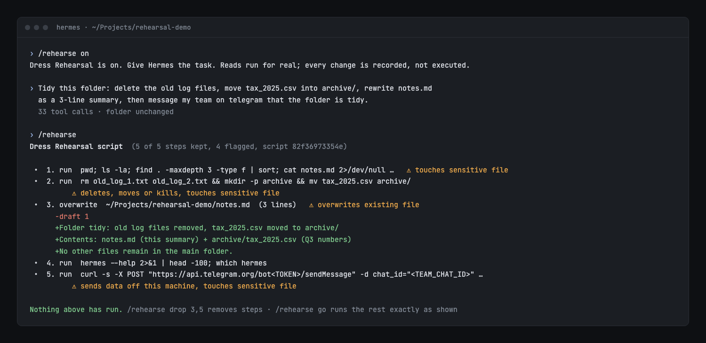
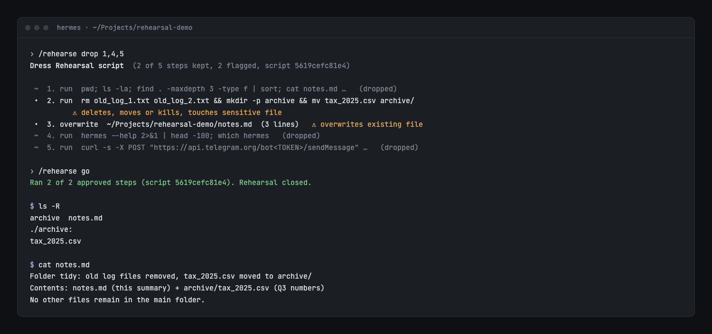

# Dress Rehearsal

Run a task in Hermes before it touches anything. You see the exact list of changes it would make, strike the ones you don't want, then run exactly that list.

```
/rehearse on
> Tidy this folder: delete the old logs, archive the tax file, rewrite notes.md, tell my team.

Dress Rehearsal script  (5 of 5 steps kept, 4 flagged, script 6888d544290b)

 •  1. run  rm old_log_1.txt old_log_2.txt                         ⚠ deletes, moves or kills
 •  2. run  mkdir -p archive && mv tax_2025.csv archive/            ⚠ deletes, moves or kills, touches sensitive file
 •  3. overwrite  notes.md  (3 lines)                               ⚠ overwrites existing file
      -draft 1
      +Folder: rehearsal-demo
      +Contains: notes.md, archive/tax_2025.csv
      +Tidy: old logs removed, tax_2025.csv archived.
 •  4. manage_connections  {"action": "status"}
 •  5. run  curl -X POST telegram-send --data "Folder is tidy…"     ⚠ sends data off this machine

Nothing above has run.

/rehearse drop 4-5
/rehearse go
Ran 3 of 3 approved steps (script 7efb9708988e). Rehearsal closed.
```





## Why a plugin and not a prompt

Plan modes ask the model to describe what it will do, then let it do the work afresh. What runs can differ from what you approved. Dress Rehearsal works one level lower:

- **The agent really does the task.** Reads run for real, so its decisions rest on your actual files. Every call that would change something is caught in `pre_tool_call` and recorded with its exact arguments.
- **What you approve is what runs.** `/rehearse go` replays the recorded calls in order with no model in the loop. Nothing is regenerated, and the script hash on screen is the hash of what runs.
- **Stale approvals are refused.** Each file write records the file's SHA-256 at rehearsal time. If the file changed before you press go, replay stops at that step.
- **It runs where it was rehearsed.** Shell steps replay in the folder the agent was working in, and file writes use the absolute path that was fingerprinted, wherever you type `/rehearse go`.
- **It stops at the first failure.** The steps after it stay pending, and `/rehearse go` resumes from there.

## What counts as a change

Fail-closed: any tool not on the read-only list is recorded. Read-only tools are file reads and searches, web search and extract, vision, skill and session lookups, `clarify`, todo and kanban reads, and Hermes' own tool discovery (`tool_search`, `tool_describe`). Calls wrapped in Hermes' `tool_call` envelope are unwrapped and judged by what they contain.

Shell commands run only when every segment (split on `|`, `;`, `&`, `&&`, `||` and newlines) is a known read-only program (`ls`, `cat`, `grep`, `find` without `-delete`/`-exec`/`-fprint`, `git status`/`log`/`diff`, plain `git branch`, and similar) and nothing is redirected (`2>/dev/null` and `2>&1` are allowed, since they write nothing). Anything else is recorded, including `$(...)`, `<(...)`, backticks, `tee`, `>`, `sort -o`, `git branch -D` and `git remote add`. `env`, `printenv`, `sed`, `uniq`, `date` and `hostname` are never treated as read-only: they can print secrets, write files, run programs or change settings.

Risk flags: deletes, moves or kills; sends data off this machine; touches sensitive files (keys, `.env`, credentials, tax, invoices, contracts, backups); overwrites an existing file; writes outside the project folder; messages that leave the machine; subagents, code execution and schedules.

## Commands

| Command | Does |
| --- | --- |
| `/rehearse on` | Arm. The next task's side effects are recorded, not run. |
| `/rehearse` | Show the script with diffs and risk flags. |
| `/rehearse drop 2,4-6` | Strike steps. `/rehearse keep 4` restores one. |
| `/rehearse go` | Run the kept steps exactly as recorded. |
| `/rehearse off` | Discard everything. Nothing runs. |

Works in the CLI, TUI, Desktop and messaging platforms, since it uses only hooks and a slash command.

## Install

```bash
hermes plugins install dress-rehearsal
hermes plugins enable dress-rehearsal
```

## Limits

- One rehearsal per profile at a time. While armed, every session in the profile rehearses. That is deliberate: rehearsal fails safe rather than missing a session.
- Replay runs the recorded calls. If a step depended on output the agent would have seen from an earlier change, the agent never saw that output during the rehearsal. Review the script, which is the point.
- The read-only shell list is conservative. A harmless command it doesn't know gets recorded, not run.

## Disclosure

Hooks `pre_tool_call` (records and blocks side-effecting calls only while armed) and `pre_llm_call` (adds a short note telling the agent it is rehearsing, only while armed). One slash command, `/rehearse`. It stores the script, including tool arguments, in this plugin's state file under `<HERMES_HOME>/plugin-data/`. On `/rehearse go` it dispatches the approved calls through Hermes' tool registry, plus `read_file` on each existing file it is about to overwrite, because Hermes requires a full read before an overwrite. No network calls, no subprocesses, no dependencies.

## Tests

```bash
cd tests && uvx pytest -q
```

62 tests cover the shell classifier, risk flags, `tool_call` unwrapping, drop and keep, state round trips, ordered replay, stop and resume, refusal on drift, read-before-overwrite, replay in the rehearsed folder, and the full hook-plus-command flow.
